<!--
  Every card on this page is a custom animated SVG.
  Fixed cards live in assets/ (regenerate: node scripts/cards.mjs static).
  Live cards are rebuilt every 6 hours by .github/workflows/profile-cards.yml and published to the output branch.
-->

 

<picture>
  <source media="(prefers-color-scheme: dark)" srcset="https://raw.githubusercontent.com/ABISHEK-K-DEV/ABISHEK-K-DEV/output/snake.svg" />
  
</picture>

